- 🤖 **Full-time agentic development with Claude Code.** I design the product, write the specs and make the calls. AI agents implement, test and iterate inside guardrails I set up.
- 🧭 **A technical and global view of IT.** IT support technician, IT project manager, entrepreneur on SaaS products: I've seen software from every side. The users who live with it, the teams who scope and deliver it, the business that has to make it worth it. I know how to frame a project, not just how to code it.
- 🛠️ **Self-taught developer.** A year of web development through **[The Odin Project](https://www.theodinproject.com/)**, writing every line by hand. Today I bring it all together: I frame the project, hold the vision and the trade-offs, and orchestrate the AI agents that build it.
- 🎮 **Several projects in active development:** games in C# / .NET (Unity & Godot), a browser extension, and the tooling around them (MCP integrations, asset pipelines, custom skills). They stay private until they're ready to ship.
- 🧠 **Exploring how far one developer can scale:** multi-agent orchestration, context engineering, spec-driven development.

<table width="100%">
  <tr>
    <td width="33%" valign="top">
      <h4>⚖️ Rigor scales with risk</h4>
      
A typo just gets fixed. A feature runs the full loop. A change that's hard to undo starts with an ADR. Process is a tool, not a ritual.

    </td>
    <td width="33%" valign="top">
      <h4>📐 Spec before code</h4>
      
A short vision and a roadmap with small milestones. ADRs only for the decisions that are expensive to reverse.

    </td>
    <td width="33%" valign="top">
      <h4>🗺️ Plan & tests first, when it counts</h4>
      
On real features, an agent explores the code and writes a plan I approve, then failing tests it isn't allowed to touch, then the code.

    </td>
  </tr>
  <tr>
    <td width="33%" valign="top">
      <h4>👀 Agents check their own work</h4>
      
Through MCP they run the game or app, read the logs and fix what's wrong. "Done" comes with proof, and with what couldn't be verified.

    </td>
    <td width="33%" valign="top">
      <h4>🔍 Human in the loop</h4>
      
I own the vision, the product calls and the final review. Agents propose, build and push back once if they disagree. I decide.

    </td>
    <td width="33%" valign="top">
      <h4>🌱 Process grows from real pain</h4>
      
Rules are added when a problem repeats, and removed when they stop paying off. Checks live in hooks, methods load on demand as skills, <code>CLAUDE.md</code> stays short.

    </td>
  </tr>
</table>

**Agentic toolchain**

**Games & 3D**

**Web & back-end**

**Ops & tooling**

**Concepts:** `Multi-agent orchestration` `Spec-driven development` `Test-driven development` `Context engineering` `Progressive disclosure` `ADRs` `Hooks & guardrails` `Architecture tests` `Clean architecture` `REST & WebSocket` `JWT auth` `SQL`

<i>📫 Building something with AI agents, or curious about the workflow? <a href="https://www.linkedin.com/in/thomas-teboul-7809201b6/">Let's talk!</a></i>

